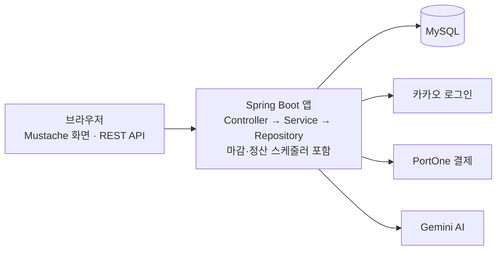

# GoodsBridge

> 오프라인 굿즈샵을 거점으로 안전 교환(보증금+노쇼 페널티)을 중개하는 굿즈 교환·거래 플랫폼

## 현재 상태
- 4인 팀 프로젝트, 개발 기간 2026-11-02 ~ 2026-11-23. 핵심 기능 구현, 시연(데모) 모드로 운영 중
- [시연 영상](https://youtu.be/i1XuUx8sua8) · [발표 자료 (PDF)](docs/ops/GoodsBridge_발표자료.pdf)
- [핵심 기능 간단 시연 (Notion)](https://app.notion.com/p/Goods-Bridge-7905b00d03be83dbabe181cbbf88cfc9?source=copy_link)

## 주요 기능
- **가게 중개 안전 교환**: 양쪽 보증금 예치, 가게의 현장 출석 확인, 노쇼 여부에 따른 보증금 정산
- **상품 판매·구매**: 카드 결제(PortOne), 배송 단계 관리, 구매 확정, 부분 환불
- **선착순 이벤트**: 정원·1인 수량 제한, 동시 참가 제어, 번호표 발급
- **경매**: 최초 입찰 시 보증금, 동시 입찰 제어, 낙찰 후 잔금 결제·미납 처리
- **가게 B2B 구독**: 유저 수수료 없이 가게 대상 구독료로 운영
- **문의·리뷰·실시간 알림**: 상품·이벤트·경매 문의, 구매 확정 후 리뷰, 고객센터 문의, SSE 알림
- **AI 챗봇**: 서비스 안내와 내 거래 조회
- **관리자 페이지**: 입점 승인, 구독·경매 관리, 고객센터 문의 답변

## 핵심 개념
| 용어 | 의미 |
|---|---|
| 보증금 | 교환 확정 시 양쪽이 상품가의 20%(최소 2,000원)를 예치. 노쇼 여부에 따라 환불하거나 가게 몫으로 정산 |
| 노쇼 정산 | 둘 다 방문하면 각자 75% 환불, 한쪽만 노쇼면 방문자 100%·노쇼 측 0% 환불, 둘 다 노쇼면 각자 50% 환불. 남은 금액은 가게 몫 |
| 비관적 락 | 이벤트·경매·교환 행을 먼저 잠근 뒤 처리해 정원 초과와 중복 정산을 막는 동시성 제어 |
| 가게 구독 | 가게(지점)가 일 단위로 결제하는 구독. 만료되면 가게 상품은 자동으로 판매 중지 |
| 시연(데모) 모드 | `APP_DEMO_ENABLED=true`로 가입·결제 없이 데모 계정(손님 A·B, 가게, 관리자)으로 체험하는 모드. 기능 시연 화면이 함께 열림 |

## 동작 방식


## 프로젝트 구조
```
GoodsBridge/
├── src/main/java/com/goodsbridge/   도메인별 패키지 (exchange, event, auction, payment, shop, user …)
│   └── _core/                       공통 예외·보안(JWT)·설정
├── src/main/resources/templates/    Mustache 화면 (도메인별 폴더)
├── src/test/                        자동화 테스트 (정산·동시성·결제)
├── docs/                            guide(사용법) · spec(기획·설계) · ops(운영)
├── deploy/                          배포용 Caddy 설정·환경변수 예시
├── Dockerfile                       앱 이미지 (빌드 → 실행 2단계)
├── docker-compose.yml               로컬 MySQL
├── docker-compose.prod.yml          배포용 (앱·MySQL·Caddy)
└── INDEX.md                         문서 색인
```

## 시작하기
```bash
cp .env.example .env     # 예시 값 그대로도 서버 기동
docker compose up -d     # 로컬 MySQL
./gradlew bootRun        # http://localhost:8080
```
사전 준비(Docker Desktop, Java 21)와 `.env` 값 구분, 테스트 실행은 [개발 환경](docs/guide/개발_환경.md), Windows 기준 순서와 막힐 때는 [로컬 실행 가이드](docs/guide/로컬_실행_가이드.md) 참고.

## 팀 구성
| 역할 | GitHub | 맡은 영역 |
|---|---|---|
| A | [@life-random](https://github.com/life-random) | 공통 예외처리, Security·JWT, 카카오·이메일 로그인, 회원정보, 인앱 알림, AI 에이전트 |
| B | [@bito4165-creator](https://github.com/bito4165-creator) | 가게, 가게 구독(B2B), 상품·카테고리, 게시판·댓글 |
| C (팀장) | [@leeyonghee030](https://github.com/leeyonghee030) | 교환, 교환 댓글, 가게 이벤트·선착순 참가<br>기획서·README·이슈, AI 에이전트 채팅 추가(#97), 기능 시연 화면 |
| D | [@DevDash-boot](https://github.com/DevDash-boot) | 결제·구매(PortOne), 정산·환불, 경매·입찰, 관리자 대시보드 |

자세한 분배와 이슈 번호는 [작업 분배](docs/ops/작업_분배.md) 참고.

## 문서 안내
- [기획서](docs/spec/기획서.md): 개요·비즈니스 모델·핵심 기능·일정 (같은 폴더에 [ERD](docs/spec/ERD.md), [API 명세](docs/spec/API_명세.md), [유저플로우](docs/spec/유저플로우.md))
- [개발 환경](docs/guide/개발_환경.md): 기술 스택, 로컬 실행 전체 순서, `.env`, 테스트 실행
- [기능 시연 화면](docs/guide/기능_시연_화면.md): 화면 경로와 동시성·노쇼 정산 시연 버튼 사용법
- [협업 규칙](docs/ops/협업_규칙.md): Git 전략, PR·커밋 규칙, 테스트 우선순위
- 전체 목록: [INDEX.md](INDEX.md)
