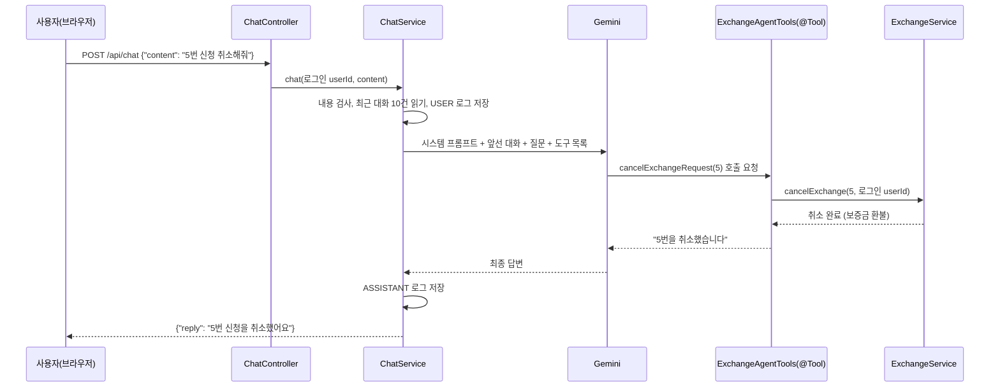
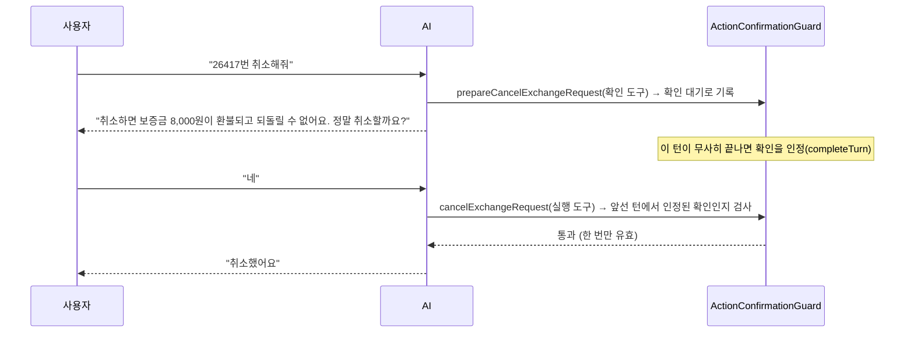

# AI 에이전트 학습 노트 (이슈 #13)

`POST /api/chat`이 어떻게 동작하는지 나중에 공부하려고 정리한 노트입니다. 코드에도 같은 설명을 주석으로 달아 두었어요.

## 1. 한눈에 보기

사용자가 "내 교환 신청 보여줘"라고 보내면, AI(Gemini)가 스스로 "교환 조회 도구를 불러야겠다"고 판단해서 **우리 서비스 메서드를 직접 실행**하고, 그 결과로 답합니다.



## 2. 파일 지도 (`com.goodsbridge.chat`)

| 파일 | 역할 |
|---|---|
| `ChatController` | `POST /api/chat`, `GET /api/chat/history`. 로그인 사용자 id를 꺼내 서비스에 넘기기만 한다 |
| `ChatService` | 핵심 흐름(검사 → 대화 불러오기 → Gemini 호출 → 저장). **여기부터 읽으면 된다** |
| `ChatConfig` | `ChatClient` 생성 + **시스템 프롬프트**(AI의 역할과 규칙) |
| `ExchangeAgentTools` | AI가 부르는 **도구**. `@Tool` 메서드 3개(교환 조회, 취소 확인, 취소 실행) |
| `ActionConfirmationGuard` | 취소처럼 되돌릴 수 없는 동작의 **이중 확인**을 서버에서 강제하는 장치 |
| `ChatLog` / `ChatRole` / `ChatLogRepository` / `ChatLogService` | 대화 기록 저장·조회 (USER, ASSISTANT, TOOL) |
| `ChatRequest` / `ChatResponse` / `ChatLogResponse` | 요청·응답 모양 |
| `static/js/chat-widget.js` + `fragments/footer.mustache` | **오른쪽 아래 고정 채팅 위젯**(모든 화면, 로그인한 손님·가게에게만) |
| `ChatViewController` + `templates/chat/index.mustache` | `/test/chat` 안내 화면 (위젯을 열어 둔다) |

## 3. 꼭 알아야 할 개념

### ChatClient
Spring AI가 제공하는 "AI와 대화하는 창구"입니다. 이렇게 이어서 씁니다.
```java
chatClient.prompt()
    .messages(history)        // 앞선 대화
    .user(message)            // 이번 질문
    .tools(exchangeAgentTools)// AI가 쓸 수 있는 도구
    .toolContext(Map.of("userId", userId))
    .call()                   // 호출 (끝날 때까지 기다린다)
    .content();               // 답변 글자만 꺼내기
```
Gemini 연결 정보(키, 모델)는 `application.yaml`의 `spring.ai.google.genai`에 있고 키는 `.env`의 `GEMINI_API_KEY`입니다.

### 시스템 프롬프트
모든 대화 맨 앞에 붙는 "AI의 역할과 규칙"입니다(`ChatConfig`). 예를 들어 "취소는 사용자가 분명히 요청했을 때만 실행해라"처럼 **AI의 행동을 말로 제한**합니다. 규칙을 바꾸려면 이 글을 고치면 됩니다.

### @Tool (함수 호출, function calling)
`@Tool`이 붙은 메서드를 AI가 "쓸 수 있는 함수"로 인식합니다. 중요한 점:
- AI는 `description`(설명 글)을 읽고 **언제 부를지 스스로 정합니다.** 설명을 잘 써야 합니다.
- AI는 메서드를 직접 실행하지 않고 "이 함수를 이 값으로 불러 줘"라고 **요청**하면, Spring AI가 대신 실행해서 결과를 돌려줍니다.
- REST 엔드포인트가 아닙니다. 서비스 메서드를 직접 부르므로 `/api/chat` 하나만 외부에 열려 있습니다.

### ToolContext (보안에서 가장 중요)
도구가 "누구 요청인지" 알아야 하는데, **로그인 사용자 id를 AI가 정하게 하면 안 됩니다.** AI가 다른 사람 id를 지어내서 남의 신청을 취소할 수 있기 때문입니다. 그래서 서버가 `toolContext`로 id를 넣어 주고, 도구는 거기서 꺼내 씁니다. AI가 보는 도구 입력에는 신청 번호만 있고, 사용자 id는 없습니다. (테스트 `springAi_callingTheCancelToolRunsTheServiceAsTheLoggedInUser`가 이걸 확인합니다)

### 대화 기억
Gemini는 지난 대화를 스스로 기억하지 않습니다. 그래서 매번 **최근 대화 10건을 DB에서 읽어 같이 보냅니다**(`findTop10ByUser_IdAndRoleInOrderByIdDesc`). TOOL 기록은 대화 문맥에서 뺍니다.

### 트랜잭션을 안 건 이유
AI 호출은 몇 초 걸립니다. `chat()` 전체를 트랜잭션으로 묶으면 그동안 DB 연결을 붙잡고 있어서, 저장만 `ChatLogService`에서 건마다 짧게 처리합니다. 그래서 AI가 실패해도 사용자 질문은 남고 답변만 없습니다.

### 이중 확인: 조회는 바로, 취소는 두 번 묻는다
조회처럼 읽기만 하는 일은 AI가 바로 도구를 불러 답합니다. **취소처럼 되돌릴 수 없는 일은 이렇게 두 단계**입니다.



- **왜 코드로 강제하나**: 프롬프트에 "확인하세요"라고만 쓰면 AI가 건너뛰거나 사용자가 "확인 없이 바로 해"라고 밀어붙일 때 따를 수 있습니다. 그래서 실행 도구는 **앞선 대화 턴에서 확인이 인정된 동작만** 실행합니다.
- 같은 턴에서 확인과 실행을 이어서 부르면 막힙니다(사용자가 답할 기회가 없었으므로).
- 확인 도구는 취소할 수 있는지(내 신청인지, 대기 중인지)를 먼저 점검하고, **취소하면 어떻게 되는지**(상태 변경, 환불 금액, 상대에게 알림, 되돌릴 수 없음)를 알려 줍니다. AI는 이를 사용자에게 설명해야 합니다.
- **설명이 사용자에게 전달된 턴만 인정합니다.** AI 호출이 중간에 실패하면(예: 한도 초과) 확인을 버려서, 사용자가 보지 못한 설명에 "네"로 취소되지 않습니다.
- 확인은 한 번만 쓸 수 있고 10분이 지나면 무효입니다. 서버 메모리에 보관하므로 서버가 여러 대가 되면 공용 저장소로 옮겨야 합니다.
- 나중에 "수정" 같은 동작이 생기면 같은 장치(`markPrepared` → `completeTurn` → `consume`)를 동작 이름만 바꿔 재사용합니다.

## 4. 직접 해 보기

1. `.env`에 진짜 키 넣기: https://aistudio.google.com 에서 무료 API 키를 받아 `GEMINI_API_KEY=...`로 바꾸고 서버를 다시 켠다 (`.env`는 커밋하지 않는다).
2. 서버를 켜고 `DEMO` 막대에서 손님 계정으로 바꾼다 (데모 `APP_DEMO_ENABLED=true`). 어느 화면에서나 오른쪽 아래의 말풍선 버튼이 보이고, 누르면 채팅 창이 열린다. (`/test/chat`은 창을 열어 둔 채 보여 준다)
3. "내 교환 신청 보여줘"를 보낸다 → 조회 도구가 실행되고, 아래에 `🔧 교환 신청 조회: N건`이 기록된다.
4. "대기 중인 신청 취소해줘" → AI가 먼저 목록을 보여 주고 번호를 되물어야 한다. 번호를 알려 주면 **취소하면 어떻게 되는지 설명하고 "정말 취소할까요?"라고 되묻는다**(이때는 아직 취소되지 않는다). "네"라고 답해야 실행된다.
5. Postman으로 해도 된다: 로그인 후 `POST /api/chat` (`{"content": "..."}`), `GET /api/chat/history`.

## 5. 도구를 하나 더 추가하려면

1. `ExchangeAgentTools`(또는 새 `...AgentTools` 클래스)에 메서드를 만들고 `@Tool(description = "...")`을 붙인다.
2. 파라미터는 `@ToolParam(description = "...")`으로 설명하고, 마지막에 `ToolContext`를 받아 `userId`를 꺼낸다.
3. 새 클래스라면 `ChatService`의 `.tools(...)`에 추가한다.
4. 서비스 메서드를 부르고, 예상되는 실패(`CustomException`)는 AI가 설명할 수 있게 문장으로 돌려준다.
5. 테스트: `ExchangeAgentToolsTest`처럼 서비스를 목으로 두고 `ToolCallbacks.from(...)`으로 인식과 입력 스키마를 확인한다.

## 6. 주의할 점

- 도구가 부르는 서비스 메서드(`getMyExchange`, `cancelExchange`)의 시그니처가 바뀌면 도구도 같이 깨진다. 교환 담당자와 맞춰 둘 것.
- 취소는 보증금 환불까지 일어나는 **되돌릴 수 없는 동작**이라, 시스템 프롬프트에 "분명한 요청일 때만"이라고 적어 두었다. 그래도 AI가 틀릴 수 있으니 중요한 동작은 확인 단계를 두는 게 안전하다.
- Gemini 호출은 비용·한도가 있다. 메시지는 1000자까지로 제한했다.
- 키 오류·한도 초과·네트워크 문제는 모두 `503`으로 돌려주고 원인은 서버 로그에만 남긴다.
- **모델 이름이 막힐 수 있다.** 처음에 쓴 `gemini-2.5-flash`는 새 키에서 `404 ... no longer available to new users`가 나왔다.
  그래서 모델은 `.env`의 `GEMINI_MODEL`로 바꿀 수 있게 했고 기본값은 `gemini-3.5-flash`다.
  같은 문제가 또 나면 서버 로그의 `Caused by: ...ClientException`을 먼저 보고, 쓸 수 있는 모델은 모델 목록 API로 확인한다.
- **무료 키는 사용량 한도가 있다(429).** 테스트를 많이 하면 `You exceeded your current quota`가 나온다. 그러면 사용자에게는 503 안내가 가고, 한도가 풀릴 때까지 기다리거나 다른 모델(`GEMINI_MODEL=gemini-3.1-flash-lite` 등)로 바꾼다. 모델마다 한도가 따로 있다.
- **모델마다 속도가 크게 다르다.** 같은 인사말이 `gemini-3.5-flash`는 2초, `gemini-3.8-flash`는 90초 넘게 걸렸다. 채팅에는 빠른 모델을 쓴다.
- 서버 로그에 실패 원인이 안 보이면 `ChatService`의 `log.warn(..., e)`가 예외 전체를 남기는지 확인한다. 맨 위 한 줄(`Failed to generate content`)만으로는 키·한도·모델 문제를 구분할 수 없다.
- AI가 인사에도 도구를 부르는 일이 있었다. 시스템 프롬프트에 "인사나 일반 질문에는 도구를 쓰지 말라"를 넣어 줄였다. 도구 사용이 이상하면 프롬프트부터 고친다.

## 7. 더 공부할 거리

- 스트리밍 응답(`.stream()`)으로 글자가 나오는 대로 보여 주기
- Spring AI의 `ChatMemory`로 대화 기억 관리 (지금은 직접 구현해서 원리가 보이게 했다)
- 도구를 읽기 전용과 변경용으로 나누고, 변경용은 사용자 확인 버튼을 거치게 하기
