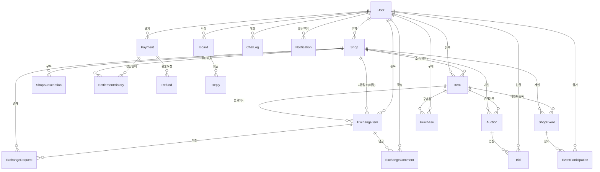

> 이 문서는 [기획서](기획서.md)에서 분리한 참조용 문서입니다. 개요·비즈니스 모델·핵심 기능은 기획서를 보세요.

# ERD — 상세 스키마 (Tier 1)

## 관계 한눈에 보기

## 테이블별 컬럼

**User**
| 컬럼 | 타입 | 설명 |
|---|---|---|
| id | PK | |
| kakaoId | String, unique | 카카오 고유 회원번호. 로그인 식별 기준 |
| nickname | String | 카카오 프로필 닉네임 |
| role | Enum(USER, ADMIN) | 가게 운영 권한은 role이 아니라 Shop.ownerUserId 소유 여부로 판단 |
| refreshToken | String, nullable | 로그아웃/재발급 검증용 (2026-11-03 추가, 이슈 #32) |
| status | Enum(ACTIVE, WITHDRAWN), default ACTIVE | 회원탈퇴 소프트 삭제용 (2026-11-03 추가, 이슈 #32) — FK로 참조하는 테이블이 많아 하드 삭제 안 함 |

> `email` 필드는 제거했습니다 (2026-11-03) — 카카오에서 이메일을 받으려면 비즈니스 인증 등 추가 설정이 필요해서, 로그인 식별에 안 쓰는(`kakaoId`로만 식별) email을 그냥 안 받기로 함. 카카오 OAuth2 scope에서도 `account_email` 제거.
| createdAt | Timestamp | |

**Shop**
| 컬럼 | 타입 | 설명 |
|---|---|---|
| id | PK | |
| ownerUserId | FK → User | |
| name | String | 지점명, 예: "OO굿즈샵 강남점" |
| region | String | 지역 필터용 |
| address | String | |
| status | Enum(PENDING, APPROVED, REJECTED) | 입점 승인 상태 |
| createdAt | Timestamp | |

**ShopSubscription**
| 컬럼 | 타입 | 설명 |
|---|---|---|
| id | PK | |
| shopId | FK → Shop | |
| setupFeePaid | Boolean | (사용 안 함, 항상 true) 초기 구축비는 체인점 본사와 별도 정산 |
| startDate / endDate | Date | |
| status | Enum(ACTIVE, EXPIRED, CANCELLED) | |

**Category**
| 컬럼 | 타입 |
|---|---|
| id | PK |
| name | String |

**Item**
| 컬럼 | 타입 | 설명 |
|---|---|---|
| id | PK | |
| sellerUserId | FK → User | |
| shopId | FK → Shop, nullable | null이면 개인판매 |
| categoryId | FK → Category | |
| title / description / price | String / String / Integer | |
| saleType | Enum(NORMAL, EVENT, AUCTION) | |
| status | Enum(ON_SALE, SOLD, CLOSED) | |
| imageUrl | String, nullable | 상품 이미지 URL (2026-11-03 추가, 이슈 #7) — Tier1은 URL 문자열만, 실제 파일 업로드(S3)는 Tier2 |
| createdAt | Timestamp | |

**ExchangeItem** (교환 게시글: 가진 것)
| 컬럼 | 타입 | 설명 |
|---|---|---|
| id | PK | |
| userId | FK → User | |
| itemId | FK → Item | 내가 가진 것 |
| wantDescription | String | 원하는 것 |
| shopId | FK → Shop | **교환장소(중개 가게). 게시글 작성 시 이름검색으로 직접 배정** (2026-11-03 추가, 이슈 #10) |
| status | Enum(OPEN, MATCHED, CLOSED) | propose(제안받음) 때는 그대로 OPEN 유지(여러 명 동시 제안 가능) → accept 때 MATCHED(경쟁 제안은 자동취소) → 정산 완료 후 CLOSED (2026-11-03 명확화, 이슈 #10/#18) |

**ExchangeComment** (교환 게시글 댓글, 2026-11-03 추가, 이슈 #33)
| 컬럼 | 타입 | 설명 |
|---|---|---|
| id | PK | |
| exchangeItemId | FK → ExchangeItem | |
| authorId | FK → User | |
| content | String | |
| createdAt | Timestamp | |

**ExchangeRequest** (매칭된 교환 건)
| 컬럼 | 타입 | 설명 |
|---|---|---|
| id | PK | |
| exchangeItemAId | FK → ExchangeItem | A의 교환 게시글 |
| itemBId | FK → Item | **B가 제안에 쓰는 본인 소유 상품 — 별도 게시글 없이 자기 Item을 바로 골라서 제안** (2026-11-03 변경, 이슈 #10: 기존엔 B도 ExchangeItem 게시글을 먼저 등록해야 했으나, 불필요한 사전 단계라 Item 직접 참조로 단순화) |
| message | String, nullable | B가 A에게 보내는 짧은 제안 메시지 (2026-11-03 추가) |
| shopId | FK → Shop | 중개 가게 — 별도 선택 없이 propose 시점에 exchangeItemA(게시글)의 shopId를 그대로 복사 |
| status | Enum(PENDING, REJECTED, CANCELLED, PROPOSAL_EXPIRED, CONFIRMED, COMPLETED, EXPIRED_PARTIAL, EXPIRED_BOTH) | `REJECTED`/`CANCELLED`/`PROPOSAL_EXPIRED`는 거절·취소·3일 무응답 자동만료 API에 대응해 추가됨 (이슈 #10) |
| depositAmountA / depositAmountB | Integer | 각자 아이템가의 20%, **단 최소 2,000원** (2026-11-03 추가) |
| userAShowed / userBShowed | Boolean | 가게가 현장 확인 후 체크 |
| deadline | Timestamp | |

**ShopEvent**
| 컬럼 | 타입 | 설명 |
|---|---|---|
| id | PK | |
| shopId | FK → Shop | |
| itemId | FK → Item | |
| capacity / currentCount | Integer | 동시성 제어 대상 |
| feeAmount | Integer | |
| maxPerUser | Integer | 1인당 최대 구매 수량 (1~10, 추가 구매 포함 합계 기준) |
| deadline | Timestamp | 모집 마감 시각 |
| visitUntil | Date | 손님 방문 날짜. 이 날이 지나야 '종료'로 분류 (비어 있으면 마감일 + 7일, 2026-11-13 추가) |
| status | Enum(OPEN, CLOSED, CANCELLED) | |

**EventParticipation**
| 컬럼 | 타입 | 설명 |
|---|---|---|
| id | PK | |
| shopEventId | FK → ShopEvent | |
| userId | FK → User | |
| ticketNumber | Integer | 번호표 (1인 1장, 같은 이벤트의 추가 구매 건도 같은 번호표) |
| quantity | Integer | 이 구매 건의 수량 |
| paymentId | FK → Payment | 구매 건마다 결제 1건 (추가 구매는 별도 행·별도 결제, 2026-11-13 변경) |
| status | Enum(JOINED, CANCELLED, REFUNDED) | |

**Auction**
| 컬럼 | 타입 | 설명 |
|---|---|---|
| id | PK | |
| shopId | FK → Shop | |
| itemId | FK → Item | |
| startPrice / currentPrice | Integer | |
| depositAmount | Integer | 최초 입찰 보증금 — **경매 개설 시 가게가 직접 정함, startPrice의 10%~20% 범위로 제한** (2026-11-03 추가, 이슈 #12) |
| currentWinnerUserId | FK → User, nullable | |
| deadline | Timestamp | |
| status | Enum(ACTIVE, ENDED_SUCCESS, ENDED_FAIL, CANCELLED) | |

**Bid**
| 컬럼 | 타입 | 설명 |
|---|---|---|
| id | PK | |
| auctionId | FK → Auction | |
| userId | FK → User | |
| bidAmount | Integer | |
| createdAt | Timestamp | |

**Board / Reply** — 기존 spring_blog 패턴 그대로 (title/content/authorId, boardId FK)

**Payment**
| 컬럼 | 타입 | 설명 |
|---|---|---|
| id | PK | |
| paymentId | String, unique | PG 거래 식별자 |
| pgTxId | String | |
| userId | FK → User | |
| amount | Integer | 승인된 전체 금액 |
| refundedAmount | Integer, default 0 | 누적 부분환불액 |
| purpose | Enum(PURCHASE, EXCHANGE_DEPOSIT, EVENT_FEE, AUCTION_DEPOSIT) | |
| status | Enum(READY, PAID, PARTIAL_CANCELLED, CANCELLED) | |

**SettlementHistory**
| 컬럼 | 타입 | 설명 |
|---|---|---|
| id | PK | |
| shopId | FK → Shop | |
| paymentId | FK → Payment | |
| amount | Integer | 가게가 가져간 몫 |
| type | Enum(EXCHANGE_FEE, AUCTION_FEE, EVENT_FEE) | |
| createdAt | Timestamp | |

**Purchase**
| 컬럼 | 타입 | 설명 |
|---|---|---|
| id | PK | |
| itemId | FK → Item | |
| buyerUserId | FK → User | |
| paymentId | FK → Payment | |
| deliveryAddress | String | |
| trackingNumber | String, nullable | |
| deliveryStatus | Enum(PREPARING, SHIPPED, DELIVERED) | |
| status | Enum(PAID, CONFIRMED, REFUNDED) | |

**Refund**
| 컬럼 | 타입 | 설명 |
|---|---|---|
| id | PK | |
| paymentId | FK → Payment | |
| requesterUserId | FK → User | |
| reason | String | |
| requestedAmount | Integer | |
| status | Enum(REQUESTED, APPROVED, REJECTED) | |

**ChatLog**
| 컬럼 | 타입 | 설명 |
|---|---|---|
| id | PK | |
| userId | FK → User | |
| role | Enum(USER, ASSISTANT, TOOL) | |
| content | Text | |
| createdAt | Timestamp | |

**Notification** (인앱 알림, 2026-11-03 추가, 이슈 #34)
| 컬럼 | 타입 | 설명 |
|---|---|---|
| id | PK | |
| userId | FK → User | 알림 받는 사람 |
| content | String | 알림 문구 |
| read | Boolean, default false | |
| createdAt | Timestamp | |

> 푸시/이메일/실시간(WebSocket) 알림은 하지 않음 — 가벼운 인앱 목록만. 교환/이벤트/경매/환불/입점승인 등 상태 변경 지점에서 각 도메인 서비스가 호출.

