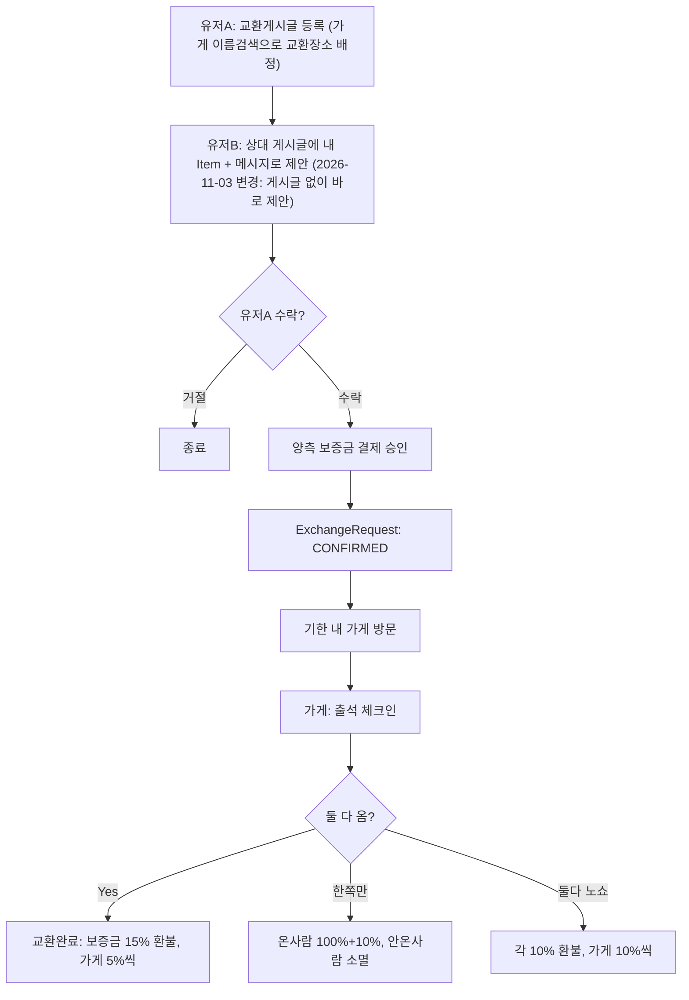
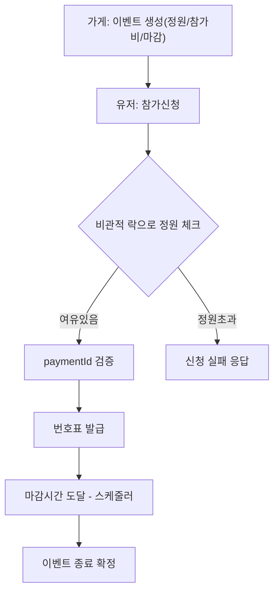
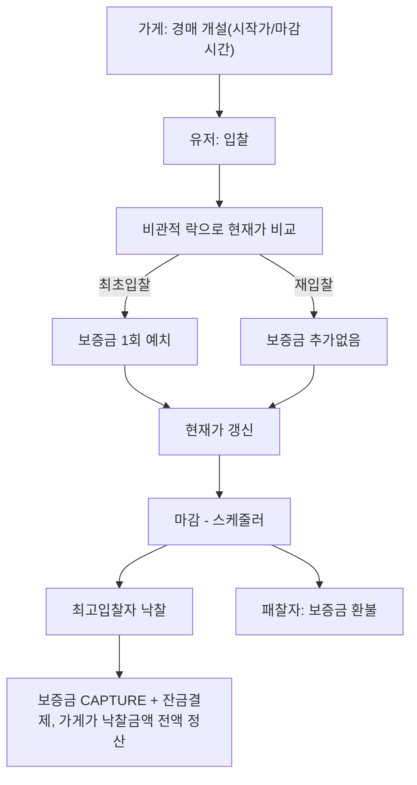
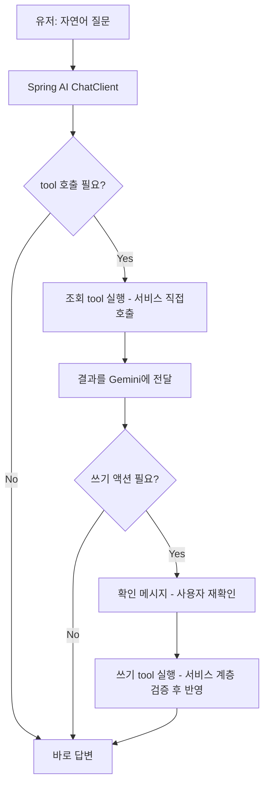

> 이 문서는 [기획서](기획서.md)에서 분리했습니다. 호출하는 API는 [API 명세](API_명세.md)를 보세요.

# 유저플로우

## 로그인
"카카오로 로그인" 클릭 → 카카오 동의 화면 → 콜백에서 최초 로그인이면 User 자동 생성(기존 유저면 조회) → 자체 JWT 발급(Access/Refresh) → 이후 요청에 Authorization 헤더 첨부

## 일반구매 (안전결제)
상품탐색 → 구매요청(배송지 입력) → PG 결제창 → paymentId 검증 → 대금 HOLD → 판매자 발송(운송장 등록) → 구매자 수령확인 → 판매자에게 RELEASE

## 가게 입점
입점신청(체인점 코드) → 관리자 승인 → 구독결제(일 단위 구독료, 승인 즉시 시작) → 활성화 → 상품/이벤트/경매 개설 가능

구독이 **만료(매일 0시 자동)되거나 관리자가 취소**하면 그 가게의 **판매중 상품만 닫히고** 판매완료 상품은 유지됩니다(배송/환불 처리를 계속하기 위해). 재구독하면 닫힌 상품이 판매중으로 복구됩니다. 구독이 끝난 가게의 상품은 전액 환불돼도 다시 판매되지 않고 닫힌 채로 둡니다.

## 교환

## 가게 이벤트

## 경매

## AI 에이전트

