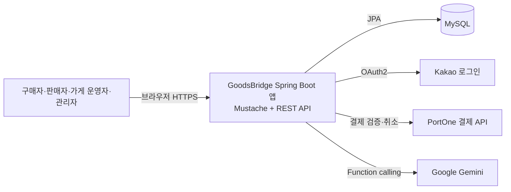
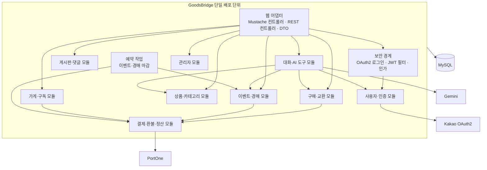

# GoodsBridge 시스템 아키텍처 설계 초안

- 작성일: 2026-11-03
- 상태: 검토용 초안
- 접근 방식: 모듈러 모놀리스

## 의도와 목표

GoodsBridge는 굿즈 판매, 가게 중개 교환, 선착순 이벤트, 경매를 지원하고, PortOne 결제와 Gemini 기반 대화 기능을 연동하는 플랫폼이다. 현재 기획과 구현 기반(Java 21, Spring Boot, Spring Data JPA, MySQL, Mustache)을 유지하면서 도메인 책임과 외부 연동 경계를 분명히 한다. 4인·14일 MVP에 맞게 한 애플리케이션과 한 관계형 데이터베이스로 배포한다.

### 목표

- 기존 도메인별 패키지 구성을 명확한 모듈 경계로 다듬는다.
- 결제 결과 반영, 교환 정산, 이벤트 정원, 경매 입찰의 핵심 불변조건을 보호한다.
- 외부 서비스 장애와 재시도 상황을 고려해 결제 및 AI 연동을 격리한다.
- MVP와 이후 확장 항목(WebSocket, S3, 실제 가게 정산)을 구분한다.

### 비목표

- 마이크로서비스, 별도 프론트엔드 애플리케이션, Redis, 메시지 브로커 도입
- Tier 2 기능 구현
- 실 PG 하위몰 계좌 정산이나 운영 규모의 고가용성 구성

## 현재 상태 및 제약

- 현재 앱은 Spring MVC 기반 단일 앱이며 `user`, `shop`, `item`, `payment`, `exchange`, `event`, `auction`, `chat`, `board`, `admin` 등의 도메인 패키지가 있다.
- Mustache 화면과 REST API가 같은 애플리케이션에 배치된다.
- 로컬 개발은 Docker Compose의 MySQL 하나를 사용한다.
- `application.yaml`에는 Kakao OAuth2, JWT, Gemini, PortOne 설정이 존재한다.
- 기획서는 결제 완료 후 `paymentId`를 서버가 PortOne에 검증하고, 승인된 결제만 도메인 상태에 반영하도록 정의한다.
- 이벤트 참가와 경매 입찰에는 DB 비관적 락을 사용하며, 마감 작업은 스케줄러로 처리한다.

## 접근 방식 검토

1. **모듈러 모놀리스 (선택)**: 하나의 Spring Boot 앱과 MySQL 안에서 도메인별 의존성과 서비스 경계를 분리한다. 현재 코드와 팀 규모에 가장 직접적으로 맞고 로컬·데모 배포가 단순하다.
2. **마이크로서비스**: 결제, 이벤트, 경매 등을 별도 배포 단위로 분리한다. 독립 확장에는 유리하지만 분산 트랜잭션, 서비스 통신, 운영 자동화 부담이 MVP 이점을 넘어선다.

모듈러 모놀리스는 현재 프로젝트 구조와 2주 MVP에 가장 적합하다. 모듈 간 호출은 우선 명시적인 서비스 인터페이스를 통한 동기 호출로 유지한다. 도메인 간 직접 엔티티 수정은 피하고 소유 모듈의 서비스가 상태를 변경한다.

## 시스템 컨텍스트

앱은 브라우저 요청의 인증과 권한을 검증하고 도메인 서비스로 전달한다. Kakao는 로그인 신원 확인, PortOne은 카드 승인 검증·취소, Gemini는 사용자 의도에 따른 제한된 도구 호출을 담당한다. 상품 이미지 저장소와 실시간 전송 계층은 MVP 범위 밖이다.

## 애플리케이션 구조

도메인 모듈은 각자의 엔티티와 리포지토리를 소유한다. 사용자 요청에 노출되는 DTO와 어댑터는 도메인 모델을 외부에 직접 노출하지 않는다. `admin`은 관리 작업의 진입점으로 동작하고, 실제 상태 변경은 대상 도메인 서비스의 권한 검사와 트랜잭션을 거친다. 공통 예외·시간·보안 유틸은 `_core`에 두되 도메인 규칙을 공통 모듈로 이동하지 않는다.

### 주요 모듈 책임

| 모듈 | 책임 |
|---|---|
| 보안·사용자 | Kakao OAuth2 콜백, 사용자 자동 생성/조회, JWT 발급·검증, 역할과 사용자 식별 |
| 가게·구독 | 입점 신청·승인 상태, 가게 소유권, 구독과 가게 운영 권한 |
| 상품 | 상품/카테고리 등록·검색, 판매 가능 상태 |
| 구매·교환 | 구매와 배송 상태, 교환 제안·수락·체크인·정산 규칙 |
| 이벤트·경매 | 참가 정원, 번호표, 입찰 순서, 종료 및 낙찰 |
| 결제·환불·정산 | PortOne 검증·취소, 결제 목적별 참조, 환불과 가게 정산 내역 |
| 대화·AI 도구 | 사용자별 대화 기록, 허용 도구, 도구 입력 검증 및 확인 절차 |
| 게시판·관리 | 게시글·댓글, 플랫폼 운영 화면 및 관리자용 명령 |

## 핵심 요청 흐름

### 로그인 및 API 인증

1. 브라우저가 Kakao OAuth2 로그인을 시작하고 Kakao 동의 화면으로 이동한다.
2. Spring Security가 콜백의 인가 코드를 처리한다.
3. 인증 성공 처리기가 Kakao ID로 사용자를 조회하거나 생성하고 Access/Refresh JWT를 발급한다.
4. REST 요청은 JWT 필터를 통과하고, 사용자·관리자·가게 소유권을 확인한다.

### 결제 기반 작업

1. 클라이언트가 결제창에서 결제를 진행하고 `paymentId`를 받는다.
2. 백엔드는 PortOne 서버 API로 결제 상태, 금액, 목적 대상과 결제자의 일치를 검증한다.
3. 검증된 결제만 `Payment`와 해당 도메인 상태에 반영한다.
4. 환불/정산은 도메인 결과에 따라 결제 모듈에서 전체 또는 부분 취소를 요청하고 내역을 기록한다.

PortOne 호출과 DB 트랜잭션은 하나의 원자적 트랜잭션이 아니다. 외부 호출을 수행하기 전에 도메인 상태를 최종 완료로 만들지 않고, 결제 처리 상태와 재시도 가능한 실패 기록을 둔다. 반복 콜백이나 중복 요청은 동일 `paymentId`가 두 번 반영되지 않도록 멱등 처리한다. 정확한 상태 열거값과 복구 UI/운영 절차는 구현 계획에서 확정한다.

### 이벤트 선착순 참가

1. 참가 요청이 이벤트 ID 행을 `PESSIMISTIC_WRITE`로 잠근다.
2. 상태, 마감, 기존 참가 여부, 현재 인원과 정원을 확인한다.
3. 허용 시 참가 번호를 결정하고 결제 검증 및 참가 생성 결과를 한 번만 반영한다.
4. 정원 초과 또는 결제 실패 시 자리를 차지한 상태가 남지 않게 실패 처리를 보장한다.

결제 외부 호출을 DB 락을 잡은 채 기다릴지 여부는 동시성·결제 일관성에 영향을 주는 설계 결정이다. 기본 설계는 짧은 DB 락 안에서 정원을 임시 확보하고, 외부 검증은 락 밖에서 실행한 후 상태를 확정 또는 만료시키는 방식으로 한다. 단, 이를 위해 임시 참가 상태와 만료 정책이 필요하므로 기획의 즉시 참가 모델과 비교해 구현 계획에서 결정해야 한다.

### 경매 입찰 및 종료

입찰은 경매 행 잠금 아래 마감 여부와 현재가를 확인한 뒤 입찰 기록과 현재 최고가를 원자적으로 갱신한다. 최초 입찰자의 보증금 결제 검증은 중복 방지 키와 함께 기록한다. 예약 작업은 마감된 경매를 배치 크기 단위로 조회하고, 경매 상태 전이를 조건부 갱신해 중복 실행에도 낙찰 처리가 한 번만 일어나게 한다. 낙찰자 결제와 패찰자 환불은 실패·재시도를 추적할 수 있도록 결제 상태를 별도로 관리한다.

### AI 대화

대화 모듈은 인증된 사용자 ID에 연결된 대화 기록만 조회한다. Gemini에 전달하는 도구는 읽기 기능과 제한된 쓰기 기능으로 나누고, 쓰기 도구는 기존 도메인 서비스를 호출해 권한·상태 검증을 재사용한다. 취소 등 상태 변경은 사용자 확인 후 실행한다. API 키와 민감한 결제정보는 모델 입력이나 대화 로그에 포함하지 않는다.

## 데이터 및 일관성

- 단일 MySQL을 사용하고 각 도메인 테이블의 소유권은 해당 도메인 모듈에 둔다.
- JPA 트랜잭션은 한 DB 안의 도메인 상태 변경에 사용한다.
- 이벤트 정원과 경매 최고가처럼 경쟁이 있는 레코드는 비관적 락 또는 조건부 갱신으로 보호하고 적절한 인덱스와 고유 제약을 둔다.
- 외부 결제 API, OAuth2, Gemini 호출은 DB 원자성 경계 밖의 실패 가능 작업으로 취급한다.
- 예약 작업은 중복 실행 가능성을 전제로 멱등하게 구현한다.
- 운영 환경에서는 스키마 변경을 버전 관리하는 마이그레이션 도구를 사용하고 자동 DDL 갱신은 개발용으로 제한한다.

## 배포와 운영

MVP 배포 단위는 GoodsBridge 애플리케이션 한 개와 MySQL 한 개다. 외부 사용자는 HTTPS 진입점을 통해 접근한다. 개발 환경의 Docker Compose는 MySQL을 제공하며 앱은 Gradle로 실행한다. 운영 배포 플랫폼과 CI/CD 방식은 별도 지정이 없으므로 구현자 결정으로 남긴다.

운영 환경에는 환경변수/비밀 저장소로 OAuth, JWT, Gemini, PortOne 시크릿을 주입한다. 로그에는 요청 추적 ID, 도메인 대상 ID, 외부 결제 참조 ID, 스케줄 작업 결과를 남기되 토큰·카드·주소 등 민감정보는 기록하지 않는다. 상태 확인용 헬스 엔드포인트와 애플리케이션 오류·결제 실패 로그는 배포 환경에 맞춰 노출한다.

## 보안 기준

- 모든 민감 API에서 인증과 리소스 소유권/가게 권한/관리자 역할을 서버가 검증한다.
- 결제 금액·구매자·목적은 클라이언트 값을 신뢰하지 않고 서버의 주문 데이터와 PortOne 조회 결과를 비교한다.
- OAuth/JWT/PG/LLM 비밀값은 저장소에 두지 않는다.
- AI 도구는 최소 권한으로 제한하고, 쓰기 기능은 사용자 확인과 도메인 서비스 검증을 통과해야 한다.
- 관리자 명령, 환불, 체크인, 입찰/정산 변경은 감사 가능한 행위 로그 대상이다.

## 성공 기준과 위험

성공 기준은 주요 도메인을 하나의 배포물로 이해할 수 있고, 결제 검증과 정산 근거를 추적할 수 있으며, 이벤트/경매 경쟁 상황에서 정원 초과나 최고가 손실이 발생하지 않는 아키텍처를 구현 가능한 수준으로 전달하는 것이다.

주요 위험은 PG 외부 호출과 DB 업데이트 간 불일치, 결제 처리 중 락 경합, 스케줄 작업 중복, 사용자 주도 AI 도구의 권한 우회다. 멱등성, 상태 전이, 최소 권한 도구, 동시성 검증으로 완화한다. 실제 PG 하위몰 정산, 파일 업로드, 실시간 알림은 별도 후속 설계가 필요하다.

## 구현자에게 남기는 결정

- 배포 대상 환경 및 CI/CD 파이프라인
- DB 마이그레이션 도구와 운영 프로파일
- 외부 결제 실패/대사/관리자 재처리 화면의 MVP 범위
- 이벤트의 임시 좌석 확보 상태와 만료 시간, 결제 호출 순서
- 경매 보증금의 의미·낙찰 후 잔금 결제·실패 시 정책
- 감사 로그 저장 형태와 보존기간
- JWT 전달/Refresh 토큰 저장 및 로그아웃·회전 정책

## 승인 후 다음 단계

이 초안이 승인되면 구현 계획을 작성한다. 구현 범위는 기존 코드를 아키텍처 경계에 맞게 정리하고 필요한 결제·동시성·스케줄 작업 흐름을 구체화하는 것이다.
