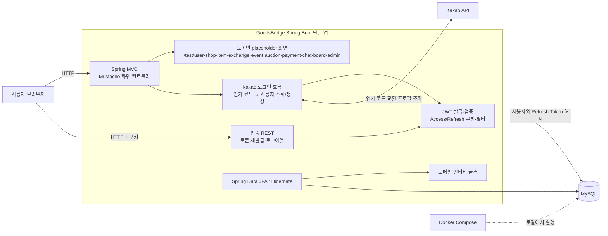

# GoodsBridge 현재 시스템 아키텍처

- 기준일: 2026-11-04
- 문서 기준: 저장소의 현재 코드와 설정
- 구조: Spring Boot 모듈러 모놀리스 (초기 골격 단계)

## 요약

GoodsBridge는 현재 Java 21과 Spring Boot 4 기반의 단일 웹 애플리케이션이다. Mustache 화면, Spring MVC 컨트롤러, 인증 코드, JPA 엔티티가 한 애플리케이션 안에 있고, 개발용 MySQL은 Docker Compose로 실행한다.

현재 동작 코드의 중심은 Kakao 인가 코드 로그인, 자체 JWT 발급 및 재발급·로그아웃이다. 주요 도메인 패키지와 일부 엔티티 파일은 존재하지만 필드와 비즈니스 동작은 대부분 미완성이다. 도메인별 화면은 `/test/{도메인}` 경로의 placeholder다. PortOne 결제와 환불은 인터페이스만 있으며 구현체는 호출 시 예외를 던진다. Gemini 설정과 대화 엔티티는 있으나 대화/도구 호출 구현은 없다.

## 현재 구조도

## 구성 요소와 현재 역할

| 구성 요소 | 현재 상태 |
|---|---|
| Spring Boot 앱 | `GoodsBridgeApplication`이 앱을 시작한다. 웹 MVC, 보안, JPA, Mustache를 한 프로세스에서 제공한다. |
| 화면 | `user`, `shop`, `item`, `exchange`, `event`, `auction`, `payment`, `chat`, `board`, `admin`의 Mustache 템플릿과 `/test/...` 화면 컨트롤러가 있다. README 기준으로 도메인 화면은 placeholder다. |
| Kakao 로그인 | Spring Security OAuth2 Client 흐름이 아니라 `KakaoApiClient`가 인가 코드와 사용자 정보를 Kakao API에 직접 요청한다. `/kakao-login`에서 Kakao로 이동하고 `/oauth2/kakao` 콜백에서 사용자를 조회하거나 생성한다. |
| JWT 인증 | Access/Refresh JWT를 발급한다. 콜백은 두 토큰을 HttpOnly 쿠키에 담는다. Refresh Token은 사용자 테이블에 SHA-256 해시로 저장하며 재발급 시 회전한다. JWT 필터는 `Authorization: Bearer` 헤더를 읽어 인증 객체를 만든다. |
| 인증 REST API | `POST /api/auth/reissue`, `POST /api/auth/logout`가 구현되어 있다. 도메인 REST API는 현재 코드에서 확인되지 않는다. |
| 도메인 패키지 | `user`, `shop`, `item`, `exchange`, `event`, `auction`, `payment`, `chat`, `board`, `admin` 패키지가 있다. 사용자 도메인에 조회·저장 경로가 일부 있고 나머지는 대부분 엔티티/화면/패키지 골격 수준이다. |
| 데이터베이스 | MySQL 8을 사용한다. Hibernate `ddl-auto` 기본값은 `update`이고, 별도 마이그레이션 도구는 현재 의존성에서 확인되지 않는다. Compose는 DB만 실행하며 앱은 Gradle로 별도 실행한다. |
| 결제 | `PaymentService` 인터페이스와 `PaymentServiceImpl` 자리만 있다. `verify`와 `refund`는 `UnsupportedOperationException`을 던진다. PortOne 클라이언트 연동은 아직 없다. |
| AI | Spring AI Gemini 의존성과 설정, `ChatLog` 엔티티는 있으나 ChatClient, `@Tool`, 채팅 서비스/API 구현은 아직 없다. |
| 예약 작업·동시성 | `@Scheduled`, `@Lock` 기반 구현은 현재 코드에서 확인되지 않는다. 이벤트·경매 엔티티만 골격으로 존재한다. |

## 로그인·요청 흐름

### Kakao 로그인

1. 브라우저가 `/kakao-login`을 요청하고, 앱은 Kakao 인가 URL로 리다이렉트한다.
2. Kakao가 `/oauth2/kakao?code=...`로 돌려보낸다.
3. `KakaoLoginService`가 인가 코드를 access token으로 교환한 뒤 프로필을 조회한다.
4. `kakaoId`로 사용자를 찾고, 없으면 `User`를 생성한다.
5. `AuthService`가 Access/Refresh JWT를 만든다. Refresh Token의 SHA-256 해시를 사용자 레코드에 저장한다.
6. 콜백은 두 토큰을 `HttpOnly`, `SameSite=Lax` 쿠키로 설정하고 `/`로 이동한다. `Secure` 여부는 `app.cookie.secure` 설정값을 사용하며 기본값은 `false`다.

### 인증된 요청

보안 필터 체인은 세션을 사용하지 않고 `Authorization: Bearer ...` 헤더에서 Access Token을 읽는다. 유효한 토큰이면 토큰의 사용자 ID와 역할을 Spring Security 컨텍스트에 넣는다. 현재 로그인 콜백은 토큰을 쿠키로 설정하므로, 쿠키 기반 화면 요청과 Bearer 헤더 기반 API 인증은 전달 방식이 다르다. 현재 보안 설정에는 쿠키에서 JWT를 읽는 기능이 없다.

`SecurityConfig`는 로그인·정적 리소스·`/test/**` 및 일부 목록 경로를 허용하고 그 외 요청에는 인증을 요구한다. 도메인별 역할 또는 가게 소유권 검사는 실제 도메인 API와 서비스가 아직 없어 구현 상태를 확인할 수 없다.

### 도메인 기능

도메인 화면 요청은 각 `*ViewController`에서 해당 Mustache 템플릿을 반환한다. 조회·거래·이벤트 참가·입찰·구매·교환 신청을 수행할 도메인 REST 컨트롤러와 서비스 흐름은 현재 구현되지 않았다. 엔티티 클래스도 대부분 `id`만 정의되어 있어 기획서의 ERD/상태 흐름과 데이터베이스가 일치한다고 간주할 수 없다.

## 현재 기술 및 설정

- Java 21, Gradle, Spring Boot 4.1.2
- Spring MVC, Spring Security, Spring Data JPA, Hibernate
- Mustache, MySQL Connector/J
- JJWT 기반 Access/Refresh JWT
- Kakao API 직접 호출 (`RestTemplate`)
- Spring AI Gemini 의존성과 모델 설정 (기능 구현 전)
- PortOne 환경 설정 키 (연동 구현 전)
- Docker Compose MySQL 8.0
- `.env`를 읽는 설정과 환경 변수 기반 비밀값 구성

## 현재 범위에서 구현되지 않은 항목

아래 항목은 기획서의 목표지만 현재 코드에서 실제 동작 구현을 확인하지 못했다.

- 상품·구매·배송·교환·이벤트·경매·게시판 도메인 API와 비즈니스 로직
- 엔티티 필드, 관계, 업무 제약, ERD 수준의 스키마
- PortOne 결제 검증·취소·환불 및 정산 내역 처리
- 이벤트 정원 경쟁 제어, 경매 입찰 잠금, 마감 예약 작업
- Gemini 대화 API, 사용자별 도구 권한, 쓰기 확인 흐름
- 운영 배포 환경, HTTPS 종단, 관측성, 장애 복구 절차
- 운영 DB 스키마 마이그레이션과 데이터 복구 정책

의존성이나 YAML 설정이 존재하는 것은 기능이 동작한다는 뜻이 아니다. 이 문서는 기획된 목표 아키텍처가 아니라 저장소에서 확인한 현재 구현을 설명한다.

## 현재 구조의 다음 단계

현재 기반을 이어 구현할 때는 우선 도메인별 Controller → Service → Repository 흐름과 실제 엔티티/관계를 완성해야 한다. 결제는 PortOne 연동 전에 결제 상태와 멱등 처리 기준을 정하고, 이벤트/경매는 DB 제약과 트랜잭션 경계를 구현해야 한다. 브라우저가 인증 쿠키를 쓰는 화면과 Bearer 토큰을 쓰는 API의 인증 전달 방식을 일관되게 정리할 필요가 있다. 운영 환경으로 전환하기 전에 스키마 마이그레이션과 비밀값·HTTPS 설정도 별도로 확정해야 한다.
