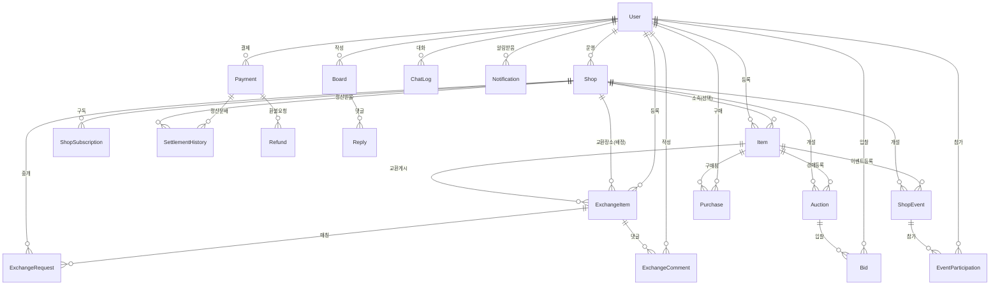
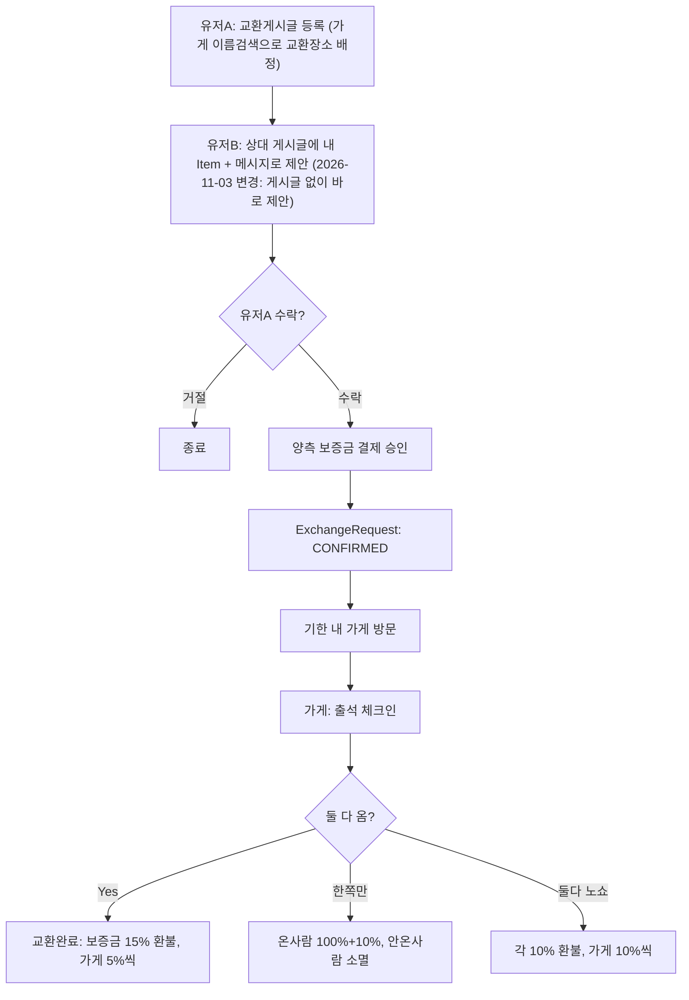
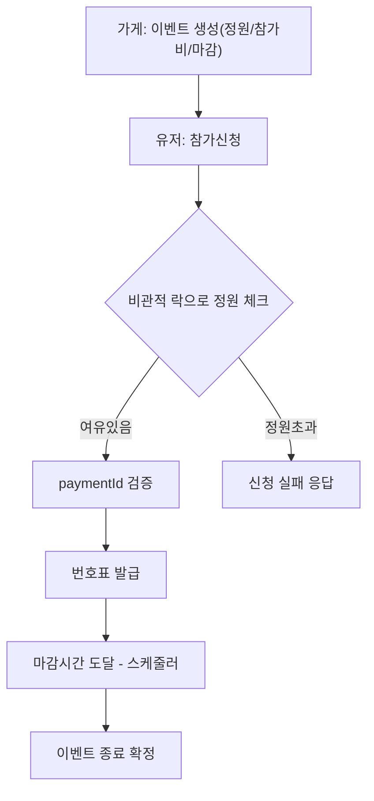
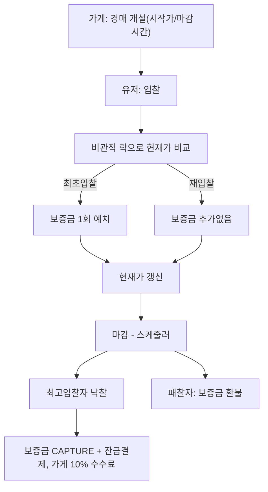
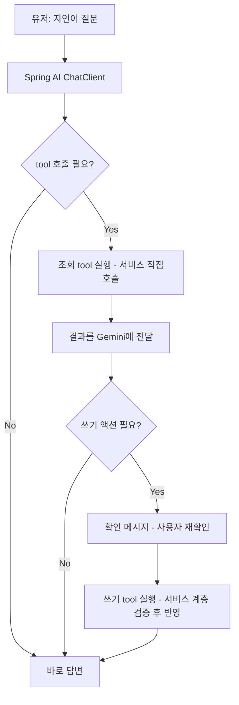

# 굿즈 교환/거래 플랫폼 — 팀프로젝트 기획서

> 4인 / 14일 / 국비·부트캠프 최종 팀프로젝트

> 📝 **2026-11-03 갱신**: 뷰단 목업으로 화면 흐름을 미리 눌러보면서 발견된 빈틈을 이슈(#32·#33·#34 신규, #6·#7·#9·#10·#12·#16·#20·#24 수정)로 반영했습니다. 아래 3.1/3.3/3.10, 5, 8, 9, 10, 11절에 그 내용이 반영돼 있습니다. 전체 구조·비즈니스모델은 변경 없음 — 세부 필드/엔드포인트 보강입니다.

## 0. 발표 요약 (엘리베이터 피치)

> 저희 주제는 **오프라인 굿즈샵과 연계한 굿즈 거래·교환 플랫폼**입니다. 흔한 당근마켓 카피캣은 하고 싶지 않아서, 지금 아이돌 포토카드·애니 굿즈 시장에서 사기가 급증하고 있는 문제를 동네 오프라인 굿즈샵을 거점으로 풀었습니다. 가게 사장님이 중간에서 실물을 확인해주는 "안전 교환" 구조입니다.
>
> 수익모델도 유저한테 수수료를 뜯는 게 아니라, **굿즈샵들에게 관리 도구를 제공하고 구독료를 받는 B2B SaaS**라 비즈니스적으로도 차별화됩니다.
>
> 14일 동안 백엔드 역량을 제대로 보여줄 수 있도록, 핵심 기술 포인트 3가지에 집중했습니다.
>
> 1. **선착순 이벤트 동시성** — 굿즈샵 오픈런 이벤트에서 마지막 한 자리를 두고 유저들이 몰리는 상황을 비관적 락으로 막고, 부하테스트 툴로 병목까지 직접 잡습니다.
> 2. **보증금 상태머신** — 교환 시 먹튀 방지를 위해 보증금을 HOLD 해뒀다가, 사장님이 현장 확인하면 CAPTURE/RELEASE하는 트랜잭션 구조를 타이트하게 설계합니다.
> 3. **AI 에이전트** — Gemini Function Calling으로 "내 교환 취소해줘" 같은 대화가 실제 DB를 조회·수정하는 에이전트를 붙입니다.

**핵심기능 한눈에**
- 오프라인 가게 경유 안전 교환 (보증금 + 노쇼 페널티)
- 가게별 선착순 이벤트 (오픈런, 동시성 제어)
- **경매** (가게 개설, 입찰 동시성 + 보증금 낙찰/패찰 전환)
- 일반 중고 상품 판매 (배송지 입력 + 발송관리)
- 가게 B2B 구독(SaaS) + 입점 신청/승인
- AI 에이전트 (Spring AI + Gemini, 조회 + 쓰기 액션)
- **플랫폼/가게 2단 관리자 페이지 (필수)**

> 이벤트의 "동시성 제어"와 교환의 "보증금 상태머신"은 경매에도 그대로 재사용됩니다 — 같은 기술 패턴을 세 가지 도메인(이벤트/교환/경매)에 공통 적용한 설계라는 게 포인트입니다.

## 1. 프로젝트 개요

**한 줄 소개**
> 기본은 중고거래 플랫폼이고, 그 위에 **굿즈 교환 · 가게 이벤트 · AI 에이전트**라는 편의 기능을 얹은 서비스

**왜 만들었는가 (문제 정의)**
- 중고거래 사기 피해액이 전년 대비 161.7% 폭증 (작년 한 해 8,740억 원). 특히 포토카드(포카) 등 굿즈 거래에서 가품 발송, 안전결제 사칭 사기가 빈번함
- 굿즈 판매점들은 각자 인스타그램 등에 재고/입고 정보를 따로 올려서, 구매자가 여러 계정을 일일이 확인해야 하는 번거로움이 있음
- 랜덤 굿즈(포토카드 등) 특성상 중복/교환 수요가 많은데, 안전하게 교환할 수 있는 창구가 없음

**차별화 포인트**
- 다른 조(티켓예약 / 중고거래 / 크라우드펀딩)와 메커니즘이 명확히 다름
- 교환은 **가게를 경유하는 오프라인 중개**로 사기 리스크를 원천적으로 낮춤 (P2P 배송 사기 구조 자체가 불가능)
- 가게별 "선착순 이벤트"에 동시성 제어 로직이 들어가 백엔드 기술력을 보여줄 수 있음

## 2. 비즈니스 모델 (수익성) — B2B SaaS

유저에게 거래 수수료를 받는 구조가 아니라, **굿즈샵을 대상으로 하는 B2B 구독 서비스**입니다. 플랫폼은 가게로부터 **초기 구축비 + 연간 구독료**만 받고, 교환 중개·이벤트 참가비 같은 거래 수익은 **가게가 직접 유저에게 받아 가져가는 가게 자체의 몫**입니다.

| 수익원 | 설명 |
|---|---|
| 초기 구축비 (1회성) | 가게가 플랫폼에 입점할 때 지불하는 셋업/온보딩 비용 |
| 연간 구독료 (SaaS) | 플랫폼을 지속 이용하기 위한 연 단위 구독료 |

> 교환 중개 수수료, 이벤트 참가비는 가게가 유저에게 직접 받는 가게 자체 매출입니다. 플랫폼은 그 거래 금액에서 별도로 수수료를 떼지 않습니다.

**가게 유치 전략 (발표용 스토리)**: 지역 파일럿 가게 1곳에 먼저 제안해 무료로 체험시켜주고 가치를 입증 → 유료 구독 전환 → 이후 "저희도 쓰고 싶어요" 하고 **가게들이 먼저 연락 오는** 셀프서비스 입점으로 확장. 기능적으로는 "입점신청 → 관리자 승인 → 구독 시작" 흐름 하나만 있으면 파일럿이든 확장이든 동일하게 작동.

## 3. 핵심 기능 — Tier 1 (필수, 2주 내 완성)

Item(상품)을 중심으로, 판매 방식만 다르게 구성 (일반판매 / 가게이벤트 / 교환이 모두 Item 기반).

### 3.1 사용자/인증
- **카카오 소셜 로그인만 지원** (아이디/비밀번호 회원가입 없음) — Spring Security OAuth2 Client + 카카오 로그인 후 자체 JWT(Access/Refresh) 발급
- 최초 로그인 시 `kakaoId` 기준으로 User 자동 생성 (별도 회원가입 절차 없음)
- 역할: 일반유저 / 가게(사장님) / 관리자
- 로그인 이후 계정 관리: **로그아웃**(refreshToken 무효화), **회원정보 수정**(닉네임), **회원탈퇴**(소프트 삭제, `status=WITHDRAWN`) — FK로 User를 참조하는 테이블이 많아 하드 삭제는 하지 않음

### 3.2 상품(Item) & 일반 판매 — 안전결제
- 상품 등록/수정/삭제 (가게·개인 모두 가능), 카테고리·지역 필터
- 상품 이미지는 `imageUrl`(nullable String) 하나만 — Tier1에서는 URL 문자열만 받고, 실제 파일 업로드(S3)는 Tier2로 유지
- 가게는 **지점 단위**로 운영 (예: "OO굿즈샵 강남점", "OO굿즈샵 홍대점") — `Shop`에 지점명 필드만 추가
- 고정가 등록 → 구매(Purchase) → **안전결제**: 대금을 HOLD해뒀다가 구매자 수령확인 후 판매자에게 지급(RELEASE). 결제 시 **배송지 주소 입력**. 수수료 없이 순수 안전장치로 제공 (일반판매 자체로는 가게·플랫폼 모두 수익 없음)

### 3.3 교환 (보증금 + 정산 규칙)

**보증금**: 교환 신청이 확정(양측 확인)되면 양쪽 모두 **자기 아이템 가치의 20%**를 보증금으로 예치 (단, **최소 2,000원** — 개인판매 아이템은 가격이 낮을 수 있어서 20%만 적용하면 보증금이 노쇼 방지 역할을 못 할 정도로 작아질 수 있음, 2026-11-03 추가)

**노쇼 판정은 가게 사장님 계정이 처리** (실물 교환 현장 확인). 기한 내 결과에 따라 아래처럼 정산됩니다.

| 상황 | 온 사람 | 안 온 사람 | 가게 수수료 |
|---|---|---|---|
| 둘 다 옴 (교환 성공) | 보증금 20% 중 15% 환불 | 보증금 20% 중 15% 환불 | 양쪽 5%씩, 총 10% |
| 둘 다 노쇼 | 보증금 20% 중 10% 환불 | 보증금 20% 중 10% 환불 | 양쪽 10%씩, 총 20% |
| 한쪽만 노쇼 | 보증금 100% 환불 | 보증금 20% 전액 소멸 (가게가 전부 가져감) | 20% |

> 모든 수수료는 **가게 몫**입니다 (섹션 2 B2B 모델과 일치 — 플랫폼은 거래 수수료를 떼지 않음).

> **2026-11-06 수정**: "한쪽만 노쇼" 케이스에서 온 사람이 상대 보증금의 10%를 추가로 받는 규칙은 제거했습니다. PortOne 환불은 원결제자 본인 카드로만 돌아가서 제3자(상대방)에게 돈을 보내는 걸 구현할 수 없고(포인트 지갑도 없음), 그래서 노쇼 쪽 보증금은 전액 가게가 가져가는 걸로 단순화했습니다. 대신 이 변경으로 "성실하게 온 사람이 보상을 못 받는다"는 불만이 나올 수 있어서, 반복 노쇼 억제책을 Tier 2로 추가했습니다 (아래 4절 참고).

**교환장소(중개 가게) 배정**: 게시글(ExchangeItem) 작성 시 글쓴이가 가게를 **이름검색으로 직접 배정**합니다 (propose/accept 시점에 따로 고르지 않음 — 제안자는 게시글의 교환장소를 보고 제안 여부를 판단).

**교환 게시글 댓글**: ExchangeItem에 댓글(ExchangeComment)을 달 수 있습니다 — 교환 조건이나 가게 관련 질문을 주고받는 용도.

**여러 명 동시 제안**: 한 게시글에 여러 명이 동시에 제안할 수 있고, 게시글 주인(A)이 그중 하나를 골라 수락합니다. 수락되는 순간 같은 게시글(또는 같은 제안 아이템)에 걸린 **다른 대기중 제안은 자동취소 + 보증금 100% 환불**됩니다. 단, B가 제안에 쓰는 아이템은 수락 전까지 다른 곳에 중복으로 걸 수 없습니다 (같은 물건을 여러 곳에 동시에 제안 방지).

### 3.4 가게별 이벤트 (선착순 모집 + 결제 + 번호표) — ★ 핵심 기술 포인트
- 가게가 이벤트 생성: 상품(Item), 모집인원, 참가비, 마감시간
- 유저 참가신청 → 결제 → 번호표(순번) 발급
- **동시성 제어**: 마지막 자리 동시신청 시 정원 초과 방지 — `WHERE 현재인원 < 정원` 조건부 업데이트 + 비관적 락
- 이벤트 취소 시 전원 환불

### 3.5 결제/정산
- **모든 결제는 카드로 받음** (PortOne 연동, 기존 spring_blog 결제 패턴 재사용)
- 보증금성 결제는 **전액 승인 후, 상황에 따라 PG 부분환불(부분취소) API로 돌려줄 몫만 환불** — 자체 HOLD 상태머신을 새로 설계하지 않고 PG가 이미 제공하는 기능을 그대로 활용 (일반판매 안전결제·교환·이벤트·경매 공통 패턴)
- 교환 수수료 분배는 3.3 표 참고 (가게 몫), 일반판매 안전결제는 수수료 없음
- **가게 정산**: 결제대금은 1차로 플랫폼 가맹점으로 승인되고, 가게 몫(수수료·낙찰금 등)은 **가게 계좌로 정산**하는 걸 목표로 설계. Tier 1 데모 범위에서는 가게용 "정산/매출 내역 조회" 화면까지 제공하고, 실제 가게 계좌 입금(PG 하위몰 정산 연동)은 실서비스화 단계 항목으로 발표 시 설명 처리

### 3.6 구매/환불
- 구매내역 조회, 환불 요청/자동처리 + 관리자 수동 승인·거절
- **판매자 발송관리 화면**: 내 판매내역에서 주문별 배송지 확인 → 운송장번호 입력 → 배송상태 변경(준비중/배송중/완료). `Purchase`에 배송지·운송장번호·배송상태 필드 추가 (별도 테이블 없이 처리, 테이블 수 변동 없음)
  - **가게(지점)용**: 거래량이 많으니 미발송 주문을 한눈에 모아보는 목록 + 운송장 일괄 등록
  - 개인 판매자용: 기존처럼 1건씩 처리

### 3.7 게시판
- 공지사항(입점 가게/굿즈 안내) CRUD, 댓글 CRUD

### 3.8 가게(Shop)
- 입점 신청 → 관리자 승인
- 지역별 가게 디렉토리 조회

### 3.9 AI 에이전트 (Spring AI + Gemini, 무료 티어)
- 구현: `spring-ai-starter-model-google-genai` 스타터 사용, Spring AI의 `ChatModel`/`@Tool` 추상화로 function calling 구현 (수동 REST 연동 대신 Spring 표준 방식)
- "내 교환/이벤트 현황 알려줘" → 실제 DB 조회 (tool calling)
- "근처에 OO 파는 가게 있어?" → 가게/상품 검색. **단, 실제 GPS 기반 거리계산은 아님** — User/Shop 어디에도 위치 좌표 필드가 없어서, 대화에서 언급된 지역 텍스트와 `Shop.region`을 매칭하는 수준 (진짜 위치기반 검색은 Tier2 "주소검색 API" 이후에나 가능)
- "이 교환 취소해줘" → 확인 단계 거쳐 실행 (쓰기 액션)
- 대화 로그 저장 (ChatLog)

### 3.10 경매 (Auction) — ★ 강사님 피드백으로 Tier 1 전환
- **가게만 경매 개설 가능** (MVP 단순화 — 개인유저 경매인증은 Tier 2로 보류)
- 입찰 — 비관적 락 동시성 제어 (이벤트와 동일 패턴 재사용)
- 최초 입찰 시 보증금 1회 예치 → 낙찰전환(CAPTURE) / 패찰환불(RELEASE) (교환과 동일 상태관리 재사용). 보증금 금액은 **경매를 여는 가게가 개설 시 직접 정함, 단 시작가의 10%~20% 범위로 제한**
- 마감 자동처리 (스케줄러)
- **수수료**: 낙찰 성사 시 **운영한 가게가 낙찰금액의 10%**를 가져감 (교환과 동일하게 가게 몫, 플랫폼은 수수료 없음)

## 4. Tier 2 — 스트레치 (시간 남으면)

- 개인유저 "경매인증" 신청 → 경매 개설 허용
- 경매 마감 임박 시 자동연장 (안티 스나이핑)
- AI 이미지 기반 진위감정
- 실시간 입찰/이벤트 현황 중계 (WebSocket/STOMP)
- 주소검색 API, 이미지 업로드(S3)
- 교환 노쇼 누적 제재 (예: 3회 무단 노쇼 시 교환 신청/수락 제한) — 3.3절 "한쪽만 노쇼" 보상 제거에 대한 보완책

> 소셜 로그인(카카오)은 원래 여기 Tier 2였으나, Tier 1 필수로 승격됨 — 3.1절 참고

## 5. 테이블 구조

**Tier 1 (20개)**: User · Shop · ShopSubscription · Item · Category · ExchangeItem · ExchangeRequest · ExchangeComment · ShopEvent · EventParticipation · Auction · Bid · Board · Reply · Payment · SettlementHistory · Purchase · Refund · ChatLog · Notification

> `PointHistory` → **`SettlementHistory`로 변경**. 모든 결제를 카드로 받는 구조로 바뀌면서 포인트 지갑 개념이 없어졌고, 대신 가게가 각 결제에서 얼마를 가져갔는지 기록하는 정산 로그 테이블로 역할이 바뀌었습니다.

> 2026-11-03: 뷰단 목업 피드백으로 **ExchangeComment**(교환 게시글 댓글), **Notification**(인앱 알림) 2개 테이블이 18개 → 20개로 추가됐습니다 (이슈 #33, #34).

**Tier 2 추가 (+2개)**: AuctionCertification · Report

## 9. ERD — 상세 스키마 (Tier 1)

### 관계 한눈에 보기

### 테이블별 컬럼

**User**
| 컬럼 | 타입 | 설명 |
|---|---|---|
| id | PK | |
| kakaoId | String, unique | 카카오 고유 회원번호. 로그인 식별 기준 |
| nickname | String | 카카오 프로필 닉네임 |
| role | Enum(USER, ADMIN) | 가게 운영 권한은 role이 아니라 Shop.ownerUserId 소유 여부로 판단 |
| refreshToken | String, nullable | 로그아웃/재발급 검증용 (2026-11-03 추가, 이슈 #32) |
| status | Enum(ACTIVE, WITHDRAWN), default ACTIVE | 회원탈퇴 소프트 삭제용 (2026-11-03 추가, 이슈 #32) — FK로 참조하는 테이블이 많아 하드 삭제 안 함 |

> `email` 필드는 제거했습니다 (2026-11-03) — 카카오에서 이메일을 받으려면 비즈니스 인증 등 추가 설정이 필요해서, 로그인 식별에 안 쓰는(`kakaoId`로만 식별) email을 그냥 안 받기로 함. 카카오 OAuth2 scope에서도 `account_email` 제거.
| createdAt | Timestamp | |

**Shop**
| 컬럼 | 타입 | 설명 |
|---|---|---|
| id | PK | |
| ownerUserId | FK → User | |
| name | String | 지점명, 예: "OO굿즈샵 강남점" |
| region | String | 지역 필터용 |
| address | String | |
| status | Enum(PENDING, APPROVED, REJECTED) | 입점 승인 상태 |
| createdAt | Timestamp | |

**ShopSubscription**
| 컬럼 | 타입 | 설명 |
|---|---|---|
| id | PK | |
| shopId | FK → Shop | |
| setupFeePaid | Boolean | 초기 구축비 결제 여부 |
| startDate / endDate | Date | |
| status | Enum(ACTIVE, EXPIRED, CANCELLED) | |

**Category**
| 컬럼 | 타입 |
|---|---|
| id | PK |
| name | String |

**Item**
| 컬럼 | 타입 | 설명 |
|---|---|---|
| id | PK | |
| sellerUserId | FK → User | |
| shopId | FK → Shop, nullable | null이면 개인판매 |
| categoryId | FK → Category | |
| title / description / price | String / String / Integer | |
| saleType | Enum(NORMAL, EVENT, AUCTION) | |
| status | Enum(ON_SALE, SOLD, CLOSED) | |
| imageUrl | String, nullable | 상품 이미지 URL (2026-11-03 추가, 이슈 #7) — Tier1은 URL 문자열만, 실제 파일 업로드(S3)는 Tier2 |
| createdAt | Timestamp | |

**ExchangeItem** (교환 게시글: 가진 것)
| 컬럼 | 타입 | 설명 |
|---|---|---|
| id | PK | |
| userId | FK → User | |
| itemId | FK → Item | 내가 가진 것 |
| wantDescription | String | 원하는 것 |
| shopId | FK → Shop | **교환장소(중개 가게). 게시글 작성 시 이름검색으로 직접 배정** (2026-11-03 추가, 이슈 #10) |
| status | Enum(OPEN, MATCHED, CLOSED) | propose(제안받음) 때는 그대로 OPEN 유지(여러 명 동시 제안 가능) → accept 때 MATCHED(경쟁 제안은 자동취소) → 정산 완료 후 CLOSED (2026-11-03 명확화, 이슈 #10/#18) |

**ExchangeComment** (교환 게시글 댓글, 2026-11-03 추가, 이슈 #33)
| 컬럼 | 타입 | 설명 |
|---|---|---|
| id | PK | |
| exchangeItemId | FK → ExchangeItem | |
| authorId | FK → User | |
| content | String | |
| createdAt | Timestamp | |

**ExchangeRequest** (매칭된 교환 건)
| 컬럼 | 타입 | 설명 |
|---|---|---|
| id | PK | |
| exchangeItemAId | FK → ExchangeItem | A의 교환 게시글 |
| itemBId | FK → Item | **B가 제안에 쓰는 본인 소유 상품 — 별도 게시글 없이 자기 Item을 바로 골라서 제안** (2026-11-03 변경, 이슈 #10: 기존엔 B도 ExchangeItem 게시글을 먼저 등록해야 했으나, 불필요한 사전 단계라 Item 직접 참조로 단순화) |
| message | String, nullable | B가 A에게 보내는 짧은 제안 메시지 (2026-11-03 추가) |
| shopId | FK → Shop | 중개 가게 — 별도 선택 없이 propose 시점에 exchangeItemA(게시글)의 shopId를 그대로 복사 |
| status | Enum(PENDING, REJECTED, CANCELLED, PROPOSAL_EXPIRED, CONFIRMED, COMPLETED, EXPIRED_PARTIAL, EXPIRED_BOTH) | `REJECTED`/`CANCELLED`/`PROPOSAL_EXPIRED`는 거절·취소·3일 무응답 자동만료 API에 대응해 추가됨 (이슈 #10) |
| depositAmountA / depositAmountB | Integer | 각자 아이템가의 20%, **단 최소 2,000원** (2026-11-03 추가) |
| userAShowed / userBShowed | Boolean | 가게가 현장 확인 후 체크 |
| deadline | Timestamp | |

**ShopEvent**
| 컬럼 | 타입 | 설명 |
|---|---|---|
| id | PK | |
| shopId | FK → Shop | |
| itemId | FK → Item | |
| capacity / currentCount | Integer | 동시성 제어 대상 |
| feeAmount | Integer | |
| deadline | Timestamp | |
| status | Enum(OPEN, CLOSED, CANCELLED) | |

**EventParticipation**
| 컬럼 | 타입 | 설명 |
|---|---|---|
| id | PK | |
| shopEventId | FK → ShopEvent | |
| userId | FK → User | |
| ticketNumber | Integer | 번호표 |
| paymentId | FK → Payment | |
| status | Enum(JOINED, CANCELLED, REFUNDED) | |

**Auction**
| 컬럼 | 타입 | 설명 |
|---|---|---|
| id | PK | |
| shopId | FK → Shop | |
| itemId | FK → Item | |
| startPrice / currentPrice | Integer | |
| depositAmount | Integer | 최초 입찰 보증금 — **경매 개설 시 가게가 직접 정함, startPrice의 10%~20% 범위로 제한** (2026-11-03 추가, 이슈 #12) |
| currentWinnerUserId | FK → User, nullable | |
| deadline | Timestamp | |
| status | Enum(ACTIVE, ENDED_SUCCESS, ENDED_FAIL, CANCELLED) | |

**Bid**
| 컬럼 | 타입 | 설명 |
|---|---|---|
| id | PK | |
| auctionId | FK → Auction | |
| userId | FK → User | |
| bidAmount | Integer | |
| createdAt | Timestamp | |

**Board / Reply** — 기존 spring_blog 패턴 그대로 (title/content/authorId, boardId FK)

**Payment**
| 컬럼 | 타입 | 설명 |
|---|---|---|
| id | PK | |
| paymentId | String, unique | PG 거래 식별자 |
| pgTxId | String | |
| userId | FK → User | |
| amount | Integer | 승인된 전체 금액 |
| refundedAmount | Integer, default 0 | 누적 부분환불액 |
| purpose | Enum(PURCHASE, EXCHANGE_DEPOSIT, EVENT_FEE, AUCTION_DEPOSIT) | |
| status | Enum(READY, PAID, PARTIAL_CANCELLED, CANCELLED) | |

**SettlementHistory**
| 컬럼 | 타입 | 설명 |
|---|---|---|
| id | PK | |
| shopId | FK → Shop | |
| paymentId | FK → Payment | |
| amount | Integer | 가게가 가져간 몫 |
| type | Enum(EXCHANGE_FEE, AUCTION_FEE, EVENT_FEE) | |
| createdAt | Timestamp | |

**Purchase**
| 컬럼 | 타입 | 설명 |
|---|---|---|
| id | PK | |
| itemId | FK → Item | |
| buyerUserId | FK → User | |
| paymentId | FK → Payment | |
| deliveryAddress | String | |
| trackingNumber | String, nullable | |
| deliveryStatus | Enum(PREPARING, SHIPPED, DELIVERED) | |
| status | Enum(PAID, CONFIRMED, REFUNDED) | |

**Refund**
| 컬럼 | 타입 | 설명 |
|---|---|---|
| id | PK | |
| paymentId | FK → Payment | |
| requesterUserId | FK → User | |
| reason | String | |
| requestedAmount | Integer | |
| status | Enum(REQUESTED, APPROVED, REJECTED) | |

**ChatLog**
| 컬럼 | 타입 | 설명 |
|---|---|---|
| id | PK | |
| userId | FK → User | |
| role | Enum(USER, ASSISTANT, TOOL) | |
| content | Text | |
| createdAt | Timestamp | |

**Notification** (인앱 알림, 2026-11-03 추가, 이슈 #34)
| 컬럼 | 타입 | 설명 |
|---|---|---|
| id | PK | |
| userId | FK → User | 알림 받는 사람 |
| content | String | 알림 문구 |
| read | Boolean, default false | |
| createdAt | Timestamp | |

> 푸시/이메일/실시간(WebSocket) 알림은 하지 않음 — 가벼운 인앱 목록만. 교환/이벤트/경매/환불/입점승인 등 상태 변경 지점에서 각 도메인 서비스가 호출.

## 6. 기술 스택

- Spring Boot, Spring Security + OAuth2 Client(카카오) + JWT, Spring Data JPA, MySQL
- **Spring AI** (`spring-ai-starter-model-google-genai`) + Google Gemini 무료 티어 — `ChatModel`/`@Tool`로 function calling 구현
- 비관적 락(`@Lock(LockModeType.PESSIMISTIC_WRITE)`) + `@Scheduled` 배치 (이벤트·경매 마감 처리)
- PortOne 카드결제 + **부분환불(부분취소) API** — 보증금 환불/수수료 로직 구현
- Mustache — 핵심 유저 화면(로그인/상품/교환/이벤트/경매/게시판) + 관리자 페이지만 서버사이드 뷰로 제공, 그 외는 전부 REST API (별도 프론트엔드 없음)

## 7. 일정 (14일 / 4인)

| 기간 | 작업 |
|---|---|
| 1~2일 | ERD 확정, API 명세, 브랜치 전략 (전원) |
| 3~5일 | JWT 로그인 + 기본 CRUD (User/Shop/Item, Board) |
| 6~9일 | **핵심 로직** — 교환 상태머신 + 이벤트 동시성 제어 + 경매(입찰·보증금) + 보증금 결제 상태관리 |
| 10~11일 | AI 에이전트(Spring AI + Gemini) + 관리자 페이지 마무리 |
| 12~13일 | 통합테스트, 부하테스트, 버그수정 |
| 14일 | 발표자료, 데모영상, (여유시) Tier 2 스트레치 착수 |

> 경매가 추가되며 "핵심 로직" 구간을 3일→4일로 늘리고, 통합테스트 구간을 하루 줄여서 맞췄습니다. 경매가 이벤트/교환과 같은 락·상태머신 패턴을 재사용하는 덕분에 가능한 조정이에요. 그래도 빡빡한 일정이니 6~9일차에 병목이 생기면 바로 Tier 2 항목부터 쳐내는 걸 전제로 합니다.

## 8. 관리자 페이지 (Tier 1 필수)

**플랫폼 관리자** 항목(입점승인/환불승인/대시보드)은 Mustache로 화면까지 제공합니다. **가게 관리자** 항목은 별도 화면 없이 기존 REST API(가게 주인이 호출)로 처리합니다.

두 종류의 관리자 권한으로 나눕니다.

**플랫폼 관리자(운영자)**
- 가게 입점 신청 승인/거절
- 가게 구독(SaaS) 상태 관리 — 결제내역, 갱신/만료 (전체 목록 조회: `GET /api/admin/subscriptions`, 2026-11-03 추가)
- 환불 요청 승인/거절 (수동 요청분)
- 전체 현황 대시보드 — 가입자 수, 거래량, 월 매출
- (스트레치) 신고 처리

**가게 관리자(샵 어드민)**
- 자기 가게 상품/이벤트 등록·관리
- 교환 노쇼 판정 (실물 교환 현장 확인 후 완료 처리)
- 자기 가게 매출/구독 현황 조회

## 10. API 명세 (Tier 1)

> 결제가 필요한 액션(이벤트참가/입찰/교환수락/구매)은 **클라이언트가 PG 결제창을 먼저 완료**하고 받은 `paymentId`를 요청 본문에 담아 보내면, 백엔드가 PortOne에 검증 요청 후 처리합니다 (기존 spring_blog 결제 패턴 재사용). 별도의 범용 "/charge" API는 만들지 않습니다.
>
> AI 에이전트는 **`POST /api/chat` 하나만 외부에 노출**됩니다. tool 함수들은 REST 엔드포인트가 아니라 서비스 계층을 직접 호출합니다.

### 인증 (카카오 소셜 로그인)
| Method | Path | 설명 |
|---|---|---|
| GET | /oauth2/authorization/kakao | 카카오 로그인 시작 (Spring Security 기본 제공, 카카오 동의 화면으로 리다이렉트) |
| GET | /login/oauth2/code/kakao | 카카오 콜백 (Spring Security가 처리) → 성공 시 User 자동 생성/조회 + 자체 JWT(Access/Refresh) 발급 |
| GET | /api/users/me | 내 정보 조회 |
| POST | /api/auth/logout | 로그아웃 — refreshToken 무효화 (2026-11-03 추가, 이슈 #32) |
| PATCH | /api/users/me | 회원정보 수정(닉네임) (2026-11-03 추가, 이슈 #32) |
| DELETE | /api/users/me | 회원탈퇴 — 소프트 삭제 (2026-11-03 추가, 이슈 #32) |

> 별도의 회원가입/로그인 API 없음. 카카오 로그인 성공 시 발급된 JWT를 그 이후 모든 요청의 `Authorization` 헤더에 사용.

### 가게(Shop)
| Method | Path | 설명 |
|---|---|---|
| POST | /api/shops | 입점 신청 |
| GET | /api/shops?name=&region=&category= | 가게 디렉토리 조회 — `name`은 부분일치 이름검색 (2026-11-03 추가, 교환장소 배정용) |
| GET | /api/shops/{id} | 가게 상세 |
| PATCH | /api/admin/shops/{id}/approve | (관리자) 입점 승인 |
| PATCH | /api/admin/shops/{id}/reject | (관리자) 입점 거절 |
| POST | /api/shops/{id}/subscription | 구독 시작/갱신 (구축비+연간구독료 결제 검증) |
| GET | /api/admin/subscriptions | (관리자) 전체 가게 구독 현황 목록 (2026-11-03 추가, 이슈 #16) |
| GET | /api/shops/{id}/settlements | 가게 정산/매출 내역 조회 |

### 상품(Item) & 일반판매(안전결제)
| Method | Path | 설명 |
|---|---|---|
| GET | /api/categories | 카테고리 목록 (프론트 드롭다운용) |
| POST | /api/items | 상품 등록 |
| GET | /api/items?category=&region=&saleType= | 목록/검색 |
| GET | /api/items/{id} | 상세 |
| PATCH / DELETE | /api/items/{id} | 수정/삭제 |
| POST | /api/items/{id}/purchase | 구매 요청 (배송지 입력 + paymentId 검증 → 대금 HOLD) |
| POST | /api/purchases/{id}/confirm | 구매자 수령확인 → 판매자에게 RELEASE |
| GET | /api/purchases/me | 내 구매내역 |
| GET | /api/payments/me | 내 전체 결제내역 조회 (목적 불문, 2026-11-03 추가, 이슈 #9) |
| GET | /api/shops/{id}/purchases?status=UNSHIPPED | 가게 발송관리 목록 |
| PATCH | /api/purchases/{id}/shipping | 운송장번호 입력 / 배송상태 변경 |

### 교환(Exchange)
| Method | Path | 설명 |
|---|---|---|
| POST | /api/exchange-items | 교환 게시글 등록 (가진 것/원하는 것 + **shopId 필수** — 이름검색으로 교환장소 배정, 2026-11-03 변경) |
| GET | /api/exchange-items?category= | 탐색 |
| POST | /api/exchange-items/{id}/comments | 댓글 작성 (2026-11-03 추가, 이슈 #33) |
| GET | /api/exchange-items/{id}/comments | 댓글 목록 (2026-11-03 추가, 이슈 #33) |
| DELETE | /api/exchange-comments/{id} | 댓글 삭제 (2026-11-03 추가, 이슈 #33) |
| POST | /api/exchange-items/{id}/propose | 교환 제안 → `ExchangeRequest` PENDING 생성 (B는 **본인 소유 Item을 바로 골라서** 제안, 별도 게시글 불필요 — 2026-11-03 변경. shopId는 게시글의 shopId를 그대로 복사) |
| POST | /api/exchange-requests/{id}/accept | 상대방 수락 → 양측 보증금 결제 검증 → CONFIRMED |
| POST | /api/exchange-requests/{id}/reject | 상대방 거절 |
| POST | /api/exchange-requests/{id}/cancel | 취소 (LLM 쓰기 액션에서도 이 서비스 메서드 재사용) |
| PATCH | /api/shops/{shopId}/exchange-requests/{id}/check-in | 가게가 현장 출석여부 기록 → 완료/노쇼 정산 처리 |
| GET | /api/exchange-requests/me | 내 교환 현황 |

### 가게 이벤트(ShopEvent)
| Method | Path | 설명 |
|---|---|---|
| POST | /api/shops/{id}/events | 이벤트 생성 |
| GET | /api/events?shopId=&status= | 목록 |
| GET | /api/events/{id} | 상세 |
| POST | /api/events/{id}/join | 참가신청 (★ 동시성 제어 지점, paymentId 검증 + 정원체크) |
| DELETE | /api/events/{id}/join | 참가취소 |
| POST | /api/events/{id}/cancel | (가게) 이벤트 취소 → 전원 환불 |
| GET | /api/events/me | 내 참가내역 |

### 경매(Auction)
| Method | Path | 설명 |
|---|---|---|
| POST | /api/shops/{id}/auctions | 경매 개설 (body에 `depositAmount` 포함 — 가게가 직접 정하되 startPrice의 10%~20% 범위, 2026-11-03 추가) |
| GET | /api/auctions?status= | 목록 |
| GET | /api/auctions/{id} | 상세 |
| POST | /api/auctions/{id}/bids | 입찰 (★ 동시성 제어 지점, 최초입찰 시 paymentId로 보증금 검증) |
| GET | /api/auctions/{id}/bids | 입찰내역 |
| GET | /api/auctions/me | 내가 참여한 경매 |

### 게시판
| Method | Path | 설명 |
|---|---|---|
| POST/GET | /api/boards | 작성/목록 |
| GET | /api/boards/{id} | 상세 |
| POST | /api/boards/{id}/replies | 댓글 작성 |
| DELETE | /api/replies/{id} | 댓글 삭제 |

### 결제/환불/관리자
| Method | Path | 설명 |
|---|---|---|
| POST | /api/refunds | 환불 요청 |
| PATCH | /api/admin/refunds/{id}/approve | (관리자) 환불 승인 → 부분/전체 취소 실행 |
| PATCH | /api/admin/refunds/{id}/reject | (관리자) 환불 거절 |
| GET | /api/admin/shops?status=PENDING | (관리자) 입점 대기 목록 |
| GET | /api/admin/dashboard | (관리자) 가입자수/거래량/매출 통계 |

### AI 에이전트
| Method | Path | 설명 |
|---|---|---|
| POST | /api/chat | 메시지 전송 → Spring AI `ChatClient` 호출 (tool calling 포함) |
| GET | /api/chat/history | 대화 로그 조회 |

### 알림 (2026-11-03 추가, 이슈 #34)
| Method | Path | 설명 |
|---|---|---|
| GET | /api/notifications/me | 내 알림 목록 (최신순) |
| PATCH | /api/notifications/{id}/read | 알림 읽음 처리 |
| PATCH | /api/notifications/read-all | 전체 읽음 처리 |

## 11. 유저플로우

### 로그인
"카카오로 로그인" 클릭 → 카카오 동의 화면 → 콜백에서 최초 로그인이면 User 자동 생성(기존 유저면 조회) → 자체 JWT 발급(Access/Refresh) → 이후 요청에 Authorization 헤더 첨부

### 일반구매 (안전결제)
상품탐색 → 구매요청(배송지 입력) → PG 결제창 → paymentId 검증 → 대금 HOLD → 판매자 발송(운송장 등록) → 구매자 수령확인 → 판매자에게 RELEASE

### 가게 입점
입점신청 → 관리자 승인 → 구독결제(구축비+연간구독료) → 활성화 → 상품/이벤트/경매 개설 가능

### 교환

### 가게 이벤트

### 경매

### AI 에이전트

## 12. 기술명세서

### 아키텍처
- Controller - Service - Repository 계층 구조, **도메인별 패키지 구조** (기존 spring_blog와 동일한 설계 철학)
- `_core` 공통 패키지(예외/유틸/설정)는 기존 spring_blog 패턴을 그대로 재사용

### 예외처리
- 상태코드별 커스텀 Exception(`Exception400`/`401`/`403`/`404`/`500`) + `GlobalExceptionHandler` — 기존 패턴 그대로 재사용

### 인증
- 기존 spring_blog: Interceptor 기반 세션 인증 → **신규: 카카오 OAuth2 로그인 + JWT 기반** (Spring Security `oauth2Login` + 커스텀 `AuthenticationSuccessHandler`에서 Access/Refresh JWT 발급, 이후 요청은 JWT Filter로 인증)
- 아이디/비밀번호 회원가입 없음 — `kakaoId` 기준으로 User 자동 생성/조회

### 동시성 제어
- JPA `@Lock(LockModeType.PESSIMISTIC_WRITE)` + `@Scheduled` 배치 (이벤트/경매 마감 처리)
- Redis는 사용하지 않음 — 트레이드오프는 발표자료에서 설명 (섹션 "Redis 안 써도 되는 이유" 참고)

### 결제
- PortOne 카드결제 + 부분환불(부분취소) API — 기존 `PortOntApiClient.cancelPayment()` 패턴 재사용

### LLM
- Spring AI `spring-ai-starter-model-google-genai` + `@Tool` 어노테이션 기반 function calling

### 개발 환경
- Java 21, Spring Boot, Gradle, MySQL (로컬)

### Git 전략
- `main` / `develop` / `feature/{domain}` 브랜치
- PR 리뷰 후 `develop` 병합, 데모 전 `main` 병합

### 테스트
- 단위테스트: JUnit5 + Mockito (기존 spring_blog 패턴)
- 부하테스트: nGrinder 또는 k6 — 이벤트·경매 동시성 지점에 집중

---

*이 문서는 강사님 컨펌 완료된 기획안입니다. ERD(9)·API 명세(10)·유저플로우(11)·기술명세서(12)까지 포함해 구현 단계로 넘어갈 준비가 된 상태입니다.*
